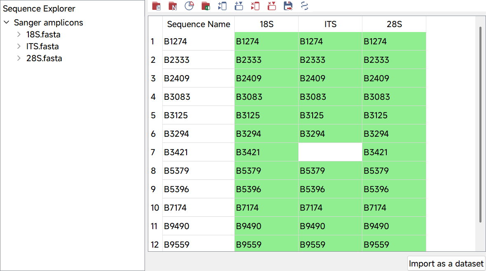
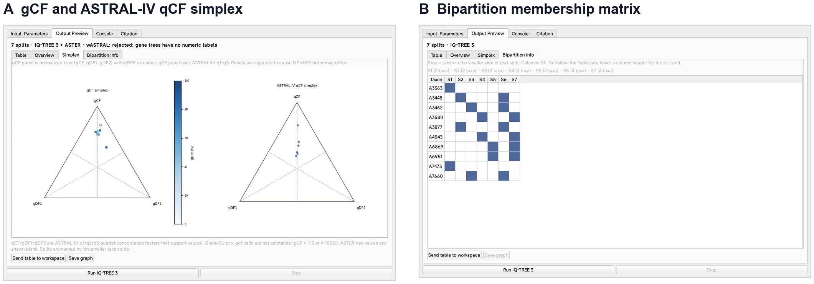
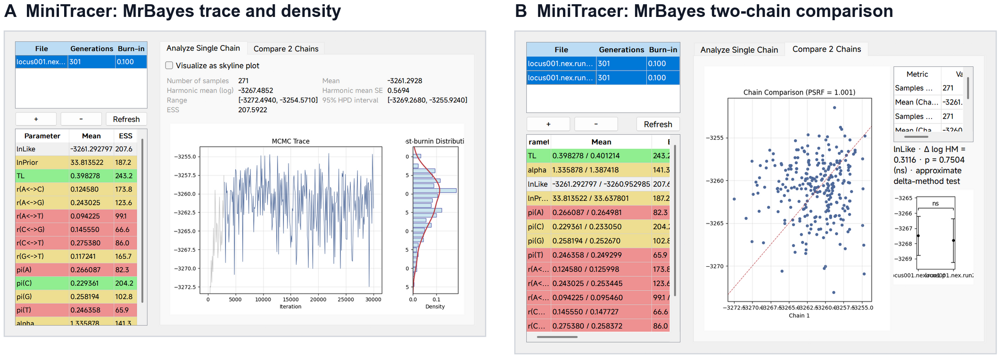
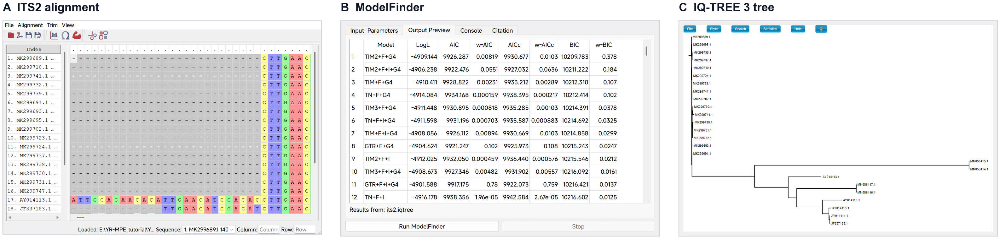

# YR-MPE — a modular, agent-operable phylogenetics workbench

[](https://github.com/Gipsy-The-Sheller/YR-MPE/releases)
[](https://www.python.org/downloads/)
[](LICENSE)
[]()

      

**YR-MPE** is a collection of molecular phylogenetics and evolution plugins
for the [YRTools](https://github.com/Gipsy-The-Sheller/YRTools) host.
**YPhylo Workbench** is the integrated environment inside YR-MPE: a typed
workspace, a provenance graph, a plugin contract and a semantic action layer
for both people and external agents.

The project targets a practical desktop workflow: import data, run a tool,
inspect the intermediate result, change a parameter, and keep the whole
analysis auditable. The same operation is available from the GUI, a JSONL
workflow and a local agent bridge.

## What's new in v1.1.0

- **YPhylo Workbench** with typed workspace objects, a provenance Inspector,
  a Selected basket and type-aware tool recommendations.
- **Local agent bridge and workflow compiler**: JSONL commands, responses and
  events; workflow DAG preview; per-plugin skills and control bindings.
- **Concordance and MSC diagnostics**: gCF, sCF, CASTER-site q1–q3,
  gCF + ASTER coalescent units, simplex and bipartition views, TreeRecs
  reconciliation.
- **More inference and selection tools**: RAxML-NG, ModelTest-NG, ASTER
  ASTRAL-IV/wASTRAL, codon Z-test, batch dN/dS and IQ-TREE codon MLE.
- **Dual-source Windows Initializer**: GitHub, Gitee or a custom binary URL;
  safe archive extraction; 20-tool `config.template.json`.
- **Documentation**: complete LaTeX user manual, case studies, tool reference
  and supplementary information.

## Why YR-MPE

Computational molecular evolution changes quickly, while an installed desktop
package often lags behind. YR-MPE is pure Python plus bundled executables, so
a repository update can be released without a compilation step. The workbench
adds the parts that a collection of launchers usually lacks:

- **typed hand-off** — an alignment, model, distance matrix, tree, tree set or
  chain is an object, not a filename convention;
- **provenance** — every run records its inputs, command, parameters and
  artifacts;
- **one contract for GUI, workflow and agent** — all three reach the same
  plugin handler;
- **Windows-native packaging** — verified x86_64 builds of tools that are
  commonly distributed as UNIX-only binaries.

## Screenshots

| SeqMatrix: Sanger amplicons | gCF/qCF simplex and bipartition |
|---|---|
|  |  |

| MrBayes convergence (MiniTracer) | Case-study gallery |
|---|---|
|  |  |

More interface figures are in the [user manual](docs/manual/manual.pdf) and
[case studies](docs/cases/cases.pdf).

## Installation

### Windows: pre-built release

1. Download the [YRTools](https://github.com/Gipsy-The-Sheller/YRTools)
   release and extract it to a writable folder.
2. Download the YR-MPE **v1.1.0 source archive** from the
   [release page](https://github.com/Gipsy-The-Sheller/YR-MPE/releases/tag/v1.1.0)
   and extract it so that the repository root is
   `<YRTools_root>/plugins/YR-MPE/`.
3. Either extract `YR-MPE-bins-win64.zip` into `YR_MPE/bin`, or let the
   **Initializer** download it from GitHub or Gitee.
4. Run `launcher.vbs` in the YRTools root. If VBScript is blocked, run
   `python main.py` instead.
5. Open **YPhylo Workbench** from the YR-MPE sidebar.

The Initializer writes `settings.json` and `YR_MPE/config.json`. A persistent
workspace is required for MrBayes, PhyloBayes and other long-running analyses;
choose it with **WORKSPACE → Select Workspace**.

### From source

```bash
git clone https://github.com/Gipsy-The-Sheller/YRTools.git
git clone https://github.com/Gipsy-The-Sheller/YR-MPE.git YRTools/plugins/YR-MPE
cd YRTools
python main.py
```

Python 3.8+ with PyQt5 (including QtWebEngine), Biopython, NumPy, pandas and
matplotlib is required. The Windows binaries are optional for source-only
use; configure external executables with the Initializer or
`YR_MPE/config.json`.

## The workbench in one minute

The toolbar is grouped by analysis stage:

| Menu | What it contains |
|---|---|
| **WORKSPACE** | workspace selection; datasets; SeqMatrix; SeqDBG; Sequence Concatenator; TreeMerger; One-Step OrthoFinder; workflow import/preview |
| **ALIGN** | open sequences; MAFFT; MUSCLE 5; Clustal Omega; MACSE 2; TrimAl; GBlocks; Sequence Viewer |
| **MODEL** | ModelFinder; ModelTest-NG; model-parameter estimation |
| **DISTANCE** | ML distance (IQ-TREE 3); uncorrected p-distance; substitution-saturation analysis |
| **PHYLOGENY** | IQ-TREE 3; RAxML-NG; MrBayes; PhyloBayes; MPBoot; DecentTree; RF comparison; MiniTracer; IcyTree |
| **SPECIES TREE** | ASTRAL-IV; wASTRAL; CASTER-site; TreeRecs; gCF; sCF; Site Diagnostics; MSC Diagnostics; BEST/MrBayes MSC |
| **CLOCK** | LSD2; MrBayes dating mode |
| **SELECTION** | codon-based Z-test (NG86/YN00); batch dN/dS; IQ-TREE codon MLE |

`ASTRAL-Hybrid` is a wASTRAL preset (support + branch length weighting), not a
separate method. `MCMCTree`/`IQ2MC` and CodeML/HyPhy are not wired in v1.1.0;
the menu entries are explicit placeholders.

## Agent and workflow support

YPhylo Workbench exposes a local, token-protected file bridge. It opens no
network port and exposes no arbitrary shell action. An agent appends JSON
commands to `commands.jsonl`; the workbench executes them on the Qt main
thread and writes `responses.jsonl` and `events.jsonl`.

```json
{"id":"open","op":"workbench.invoke_plugin","plugin":"mafft",
 "input":{"item_id":"seq_001"}}
{"id":"set","op":"plugin.modify_options",
 "options":{"mode":"Auto mode (--auto)","direction":"--adjustdirection"}}
{"id":"run","op":"plugin.run"}
{"id":"export","op":"plugin.export_to_workspace"}
```

A recorded run can be compiled into a portable workflow:

```json
{"schema":"yrmpe.workflow.v1","kind":"workflow",
 "name":"sanger-demo","inputs":{"raw":"raw.fas"}}
{"id":"mafft","op":"mafft.run",
 "outputs":{"alignment":"work/aligned.fas"},
 "params":{"input":"raw.fas","output":"work/aligned.fas",
           "direction":"--adjustdirection"}}
```

The compiler drops failed/read-only steps, assigns symbolic placeholders,
rewrites inputs and validates the DAG. The preview is editable; clicking a
tool node opens its plugin in workflow mode.

Plugin authors should implement `control_bindings()` and ship a Markdown skill
under `YR_MPE/skills/`. See [the manual](docs/manual/manual.pdf), Chapter 15,
for the AI-readiness requirements.

## Documentation

- [User manual](docs/manual/manual.pdf) — installation, interface, every menu,
  agent bridge and plugin development.
- [Case studies](docs/cases/cases.pdf) — single-gene ITS2, Sanger multi-locus,
  organelle genomics, distance methods, MrBayes, infinite CAT, species tree,
  dating and selection.
- [Tool reference](docs/manual/tool-reference.pdf) — plugin-by-plugin GUI/CLI/
  agent reference generated from the skills.
- [Supplementary information](https://github.com/Gipsy-The-Sheller/YR-MPE/releases/download/v1.1.0/YR-MPE-1.1.0-supplementary-information.pdf)
  — benchmark notes and implementation details.
- [Wiki](https://github.com/Gipsy-The-Sheller/YR-MPE/wiki) — older tutorials
  and development notes; the PDF manual is the current reference.

Example datasets used by the case studies are in
[`examples/cases/`](examples/cases/), with provenance and reproduction notes.

## Status and limitations

YR-MPE is a research workbench, not a replacement for the individual analysis
programs. Current boundaries:

- Windows is the primary packaged platform; Linux/macOS can run the Python
  plugins but not the bundled Windows executables.
- The bundled ASTER reports **v1.24**; the ASTER2 migration is planned but not
  part of this release.
- The workflow compiler and preview are implemented; a general executor that
  replays every step without review is still being completed.
- CodeML/HyPhy, MCMCTree and IQ2MC are not wired.
- Some bundled Windows builds (notably DecentTree) can fail on particular
  matrices; the manual documents the fallback.
- The controlled agent/CLI benchmark and workflow timing study are ongoing.

## Citation

The manuscript is in preparation. Until a DOI is available, cite the release:

```bibtex
@software{yrmpe2026,
  title   = {YR-MPE: a modular desktop platform for agent-operable and
             reproducible phylogenetic workflows},
  author  = {Xu, Zhijie and Jia, Yiyang and Gu, Zhihan and Shang, Mingrui and
             Cheng, Xinbo and Han, Shuo and Jin, Yang and Lei, Yitong and
             Zhang, Rui and Zhang, Yunlong},
  year    = {2026},
  version = {1.1.0},
  url     = {https://github.com/Gipsy-The-Sheller/YR-MPE/releases/tag/v1.1.0}
}
```

## Contributing

Issues and pull requests are welcome. For a new plugin, start from the
developer guide in the manual and the plugin template; include a skill file,
control bindings, a `ResultSpec` and tests. Do not commit local
`config.json`/`settings.json` or agent-bridge tokens.

## License

GPL-3.0. Bundled programs retain their original licenses; see
[`LICENSE`](LICENSE) and the individual binary directories.
